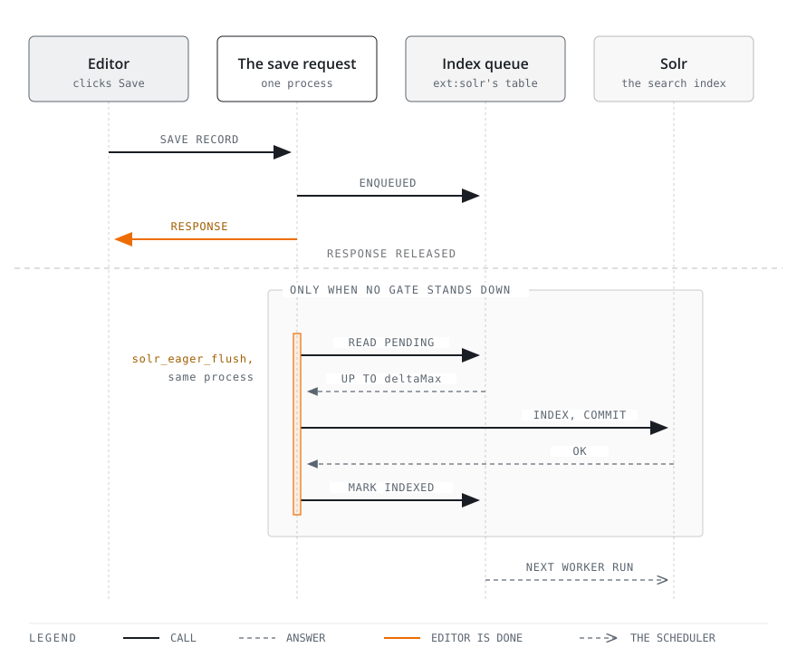

<p align="center">
  
</p>
<h1 align="center">solr-eager-flush</h1>
<p align="center"><em>A saved record reaches Solr at the end of the same request, not on the next scheduler run.</em></p>
<br>

<p align="center">
  <a href="https://github.com/wazum/solr-eager-flush/actions/workflows/tests.yml"></a>
  <a href="https://packagist.org/packages/wazum/solr-eager-flush"></a>
  <a href="https://get.typo3.org"></a>
  <a href="https://www.php.net"></a>
  <a href="LICENSE"></a>
</p>

> "This is a truly brilliant feature; it's a huge help during testing and eliminates countless follow-up questions and misunderstandings in support for editorial teams who want to see their changes quickly and have little understanding of asynchronous update processes."
>
> — Wolfgang T., project manager at [*plan2net*](https://github.com/plan2net)

## The idea

With `apache-solr-for-typo3/solr` in its default [`monitoringType = 0`](https://docs.typo3.org/p/apache-solr-for-typo3/solr/main/en-us/Configuration/Reference/ExtensionSettings.html) mode, saving a record only writes a row into `tx_solr_indexqueue_item`. The document reaches Solr whenever the [Index Queue Worker](https://docs.typo3.org/p/apache-solr-for-typo3/solr/main/en-us/Backend/IndexQueue.html) task next runs, which is usually minutes later and sometimes not until someone notices the cron is broken. Editors search for what they just published, find the old version, and open a support ticket.

**This extension indexes those queued items at the end of the same save request.** On PHP-FPM it does that after the response has gone back to the editor, so the save itself returns as fast as it did before and the indexing happens in the time the editor spends reading the page they landed on.

Nothing about the queue changes. ext:solr still owns it, the Index Queue Worker still works, and every save that this extension decides to leave alone stays in the queue for that task to pick up.

## How it works

ext:solr fires a [`ProcessingFinishedEvent`](https://docs.typo3.org/p/apache-solr-for-typo3/solr/main/en-us/Development/Events.html) once it has updated its queue for a save. This extension listens for it, works out which site roots the record belongs to, and registers one flush for the end of the request. Several saves in one request collapse into a single flush per site.

<picture>
  <source media="(max-width: 700px)" srcset="diagrams/eager-flush-on-save-narrow.svg">
  
</picture>

Three gates can tell the flush to stand down, and each of them leaves the items to the scheduler:

- a **backlog** of more than `indexQueueLimit` pending items, so bulk changes stay with the task that is built for them,
- an **Index Queue Worker** that is running right now, so the two do not index the same items,
- **another request** already flushing the same site.

A site can also be skipped on its own: eager flush is switched off for it, or its Solr does not answer a quick ping. Whatever happens, a failure is logged and never breaks the save.

## Install

```bash
composer require wazum/solr-eager-flush
```

There is nothing to configure to get started. The defaults index records and leave pages to the scheduler, because ext:solr indexes a page by rendering it.

## Configuration

Under **Settings → Extension Configuration → solr_eager_flush**:

| Setting | Default | What it does |
|---|---|---|
| `typeFilter` | `records` | Which item types to flush eagerly: `records`, `pages` or `both`. Pages are opt-in because indexing one renders it. |
| `indexQueueLimit` | `5` | Stand down when more than this many items are already pending. |
| `deltaMax` | `10` | Most items to index per request, per site root. |

Eager flush is on for every site. To leave one site on queue-based indexing, put `solr_eager_flush_enabled: false` in its site configuration.

[REFERENCE.md](REFERENCE.md) covers all three settings in full, along with what each one protects you from.

## Documentation

| Document | What it covers |
|---|---|
| [REFERENCE.md](REFERENCE.md) | requirements, where the flush runs per server API, the gates, the settings, per-site control, and how to read the log |
| [CHANGELOG.md](CHANGELOG.md) | what changed in each release |

## Licence

GPL-2.0-or-later
